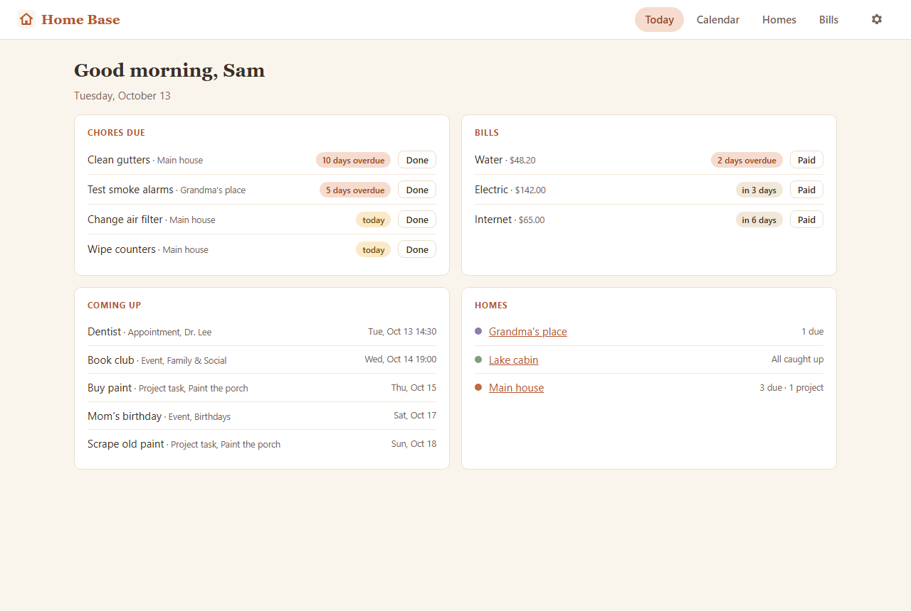
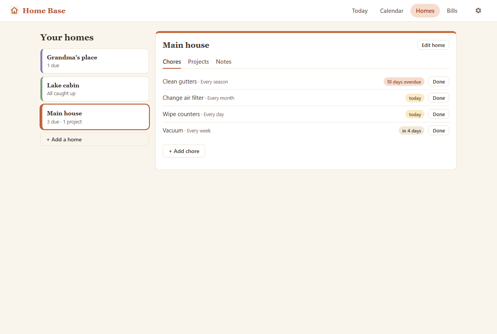

# Home Base

Home Base is a household command center for the person who keeps a home
running. Chores, bills, appointments and family events live in one place, and
the Today page tells you what needs attention. It handles more than one home: a
main house, a cabin, a parent's place.

Everything stays on your computer as plain Markdown notes in a folder you
choose. There are no accounts and nothing goes online.





## What's in it

- **Today.** Chores due, bills due this week, what's coming up, and how each home is doing.
- **Calendar.** Month, week and day views of events, birthdays, appointments, bills, chores and project tasks.
- **Homes.** Each place you look after, with its chores, projects and notes.
- **Bills.** What's due and what's paid this month, with a history kept in each bill's note.
- **Settings.** Your name, your default home, backups and anything that needs attention.

## Install it

The easy way is to ask Claude Code or Codex to "install Home Base from
github.com/HelloSteph1975/home-base by following AGENTS.md".

By hand, with Node.js 24 or newer:

```bash
git clone https://github.com/HelloSteph1975/home-base.git
cd home-base
npm install
npm run setup
npm start
```

Then open http://127.0.0.1:4173/. On Windows, `npm run install-windows` also
starts Home Base each morning, stops it at 9 PM, and adds a Desktop shortcut.

## Try the demo

`npm run demo` starts Home Base with a made-up household on
http://127.0.0.1:4205/. It uses its own temporary folder and is rebuilt each
time.

## Your data

Your notes live in `Documents/Home Base Data` unless you choose another folder
in `config.json`. Each chore, bill, event or home is one Markdown note, so you
can open the folder in [Obsidian](https://obsidian.md) or any text editor.

```
Homes/                       one note per home
Home Maintenance/            chores, by how often they repeat
Projects/<project>/          Project Info.md and a Tasks folder
Events/                      Birthdays, Holidays, Family & Social, Other
Appointments/
Bills/                       each bill note keeps its payment history
Home Base Settings.md
```

## Backups

Home Base backs up every note once a day and keeps 30 days. You can also back
up from Settings → Backups, see what changed since a backup, and restore one
note or all of them. Choose a backup folder on another drive, a USB stick or a
cloud folder so a broken laptop doesn't take your backups with it.

## Updating and uninstalling

See [AGENTS.md](AGENTS.md). Neither ever touches your data folder.

## License

MIT. See [LICENSE](LICENSE).
